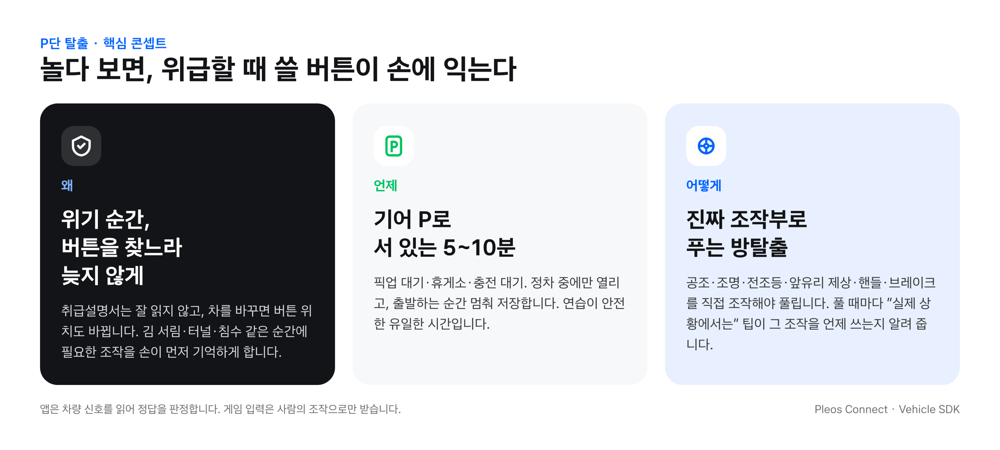
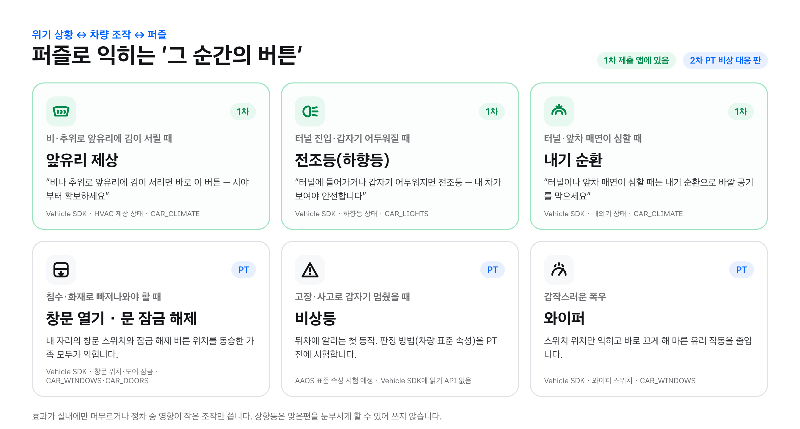
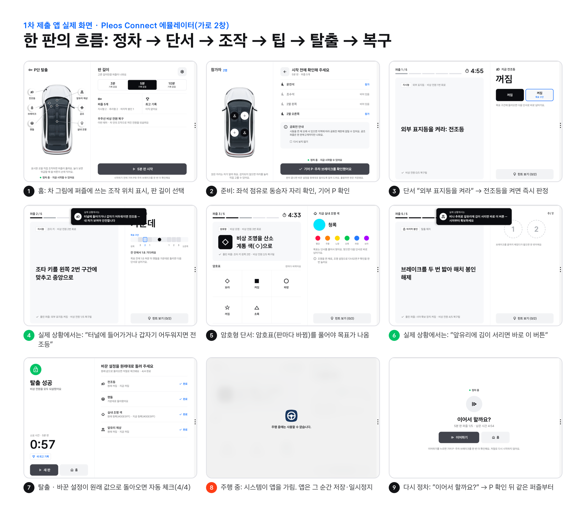

# P단 탈출 (ParkEscape)

> 한 줄 소개: 기어 P로 서 있는 5분, 내 차의 실제 조작부를 만져야 풀리는 방탈출 게임 — 놀다 보면 위급할 때 쓸 버튼이 손에 익습니다.

Pleos Connect(현대자동차그룹 차량용 인포테인먼트 플랫폼)에서 동작하는 차량용 Android 앱입니다. 현대자동차그룹 차량용 앱 개발 공모전 출품작입니다.

많은 운전자가 취급설명서를 읽지 않고, 차를 바꾸면 버튼 위치도 바뀝니다. 김 서림·터널·침수 같은 위기 순간에 필요한 조작을 찾느라 늦지 않도록, 정차 중에 실제 조작부로 퍼즐을 풀며 손에 익히게 합니다. 시연 영상은 [`demo/GearP_ParkEscape_demo.mp4`](demo/GearP_ParkEscape_demo.mp4), 기획 상세는 [`docs/app-plan.md`](docs/app-plan.md)에 있습니다.

- 기어가 P(정차)일 때만 판이 열립니다. 판마다 퍼즐 조합·순서·목표값·암호표가 바뀝니다(3·5·10분 판).
- 단서를 풀어 차의 조작부(공조 온도·풍량·내외기·앞유리 제상, 앰비언트 색·밝기, 독서등, 전조등, 핸들, 브레이크)를 직접 조작하면, 앱이 Vehicle SDK로 그 값을 읽어 정답을 판정합니다. 앱은 차를 제어하지 않습니다.
- 놀면서 위급할 때 쓸 버튼이 손에 익도록, 앞유리 제상·전조등·내기 순환 퍼즐을 풀면 "실제 상황에서는" 카드로 그 조작을 언제 쓰는지 한 줄로 알려 줍니다. 앞유리 제상과 내기 순환은 같은 판에 나오지 않습니다(김 서림에는 외기가 맞고, 차종에 따라 제상이 외기로 바꿉니다).
- 좌석 점유로 동승자 자리를 잡고, 그 자리에서만 풀 수 있는 단서(독서등)를 섞어 함께 풉니다.
- 출발(기어 D)하면 시스템이 앱을 가리는 순간 판을 저장하고 멈춥니다. 다시 정차하면 P 확인을 거쳐 이어합니다. 판이 끝나면 바꾼 설정을 원래대로 돌리도록 체크리스트를 보여 줍니다.

## 실행 방법

1. Pleos Connect Emulator v2.1.0 AVD를 **콜드 부팅**으로 실행합니다. 설치 방법은 Pleos 개발 문서의 [Pleos Connect Emulator 설치 및 실행](https://document.pleos.ai/docs/connect/guide/getting-started/application-development/setup-connect-sdk-emulator)을 참고하세요. 부팅 직후 1~2분은 시스템 UI가 안정되지 않으니 기다립니다.
2. **Virtual Console을 열어 둡니다.** `adb forward tcp:8088 tcp:8088` 후 브라우저에서 `http://127.0.0.1:8088/`을 열고, 테스트하는 동안 그 탭을 닫지 않습니다. 이 에뮬레이터는 Virtual Console 창(세션)이 열려 있을 때만 공조·조명 값을 차량에 반영하고, 콜드 부팅 뒤 한 번도 열지 않으면 공조 값이 비어 있습니다(아래 "테스트 환경" 참고).
3. 에뮬레이터에 앱을 설치합니다.
   - 제출용 APK: `adb install -r apk/GearP_ParkEscape_release.apk`
   - 소스에서 빌드: `./gradlew installDebug` (release와 서명이 달라 먼저 `adb uninstall com.team.pleosapp`)
4. 앱 라이브러리에서 **P단 탈출**을 실행합니다.
5. 기어가 P일 때 판 길이를 고르고 "시작" → 참가 자리 확인 → "기어 P·주차 브레이크를 확인했어요"를 누르면 판이 시작됩니다.
6. 화면의 단서대로 Virtual Console에서 값을 바꾸면 퍼즐이 풀립니다.
   - 공조(목표 온도·풍량·내외기·앞유리 제상): Climate
   - 앰비언트 색·밝기, 독서등, 전조등(외부등 Low Beam): Convenience
   - 핸들 각도, 브레이크: Motion
   - 기어 P/D: Motion. D로 바꾸면 시스템이 앱을 "주행 중에는 사용할 수 없습니다." 화면으로 덮고, 앱은 그 순간 판을 저장하고 일시정지합니다. 다시 P로 바꾸면 "이어하기" → P 확인으로 같은 퍼즐부터 이어집니다(저절로 다시 시작하지 않음).

### 디버그 빌드 전용 옵션
- 시연 시드 고정: `adb shell am start -n com.team.pleosapp/.MainActivity --es seed demo5` (신호 풀 10종 고정, 기획 5절 시연 판). `--es seed demo-safety`는 위급할 때 쓰는 조작을 손에 익히는 5분 판입니다(전조등 → 핸들 → 앰비언트 색 → 앞유리 제상 → 브레이크).
- Fake SDK 빌드(`-Ppleos.useFakeSdk=true`)에서 주행 상태 바꾸기: `adb shell am start -n com.team.pleosapp/.MainActivity --es fakeGate drive` (`park`·`idle`·`drive`)
- Fake SDK 빌드는 퍼즐마다 6초 뒤 신호를 목표값으로 바꿔 판을 자동으로 풀고, 결과 화면에서 6초 뒤 원래 값으로 되돌립니다(영상 예비용). 끄기: `--ez autoPlay false`
- 시드를 고정해(debug 빌드) 시작하면 시연 0단계(운전석 24℃, 앰비언트 청록 `#00e5ff`, 풍량 2단, 앞유리 제상 꺼짐, 전조등 꺼짐(Virtual Console `Off`), 운전석 점유)와 다른 값을 보여 주고 그대로 시작할지 묻습니다. release 빌드에는 없습니다.
- 주행 전환 측정 로그: `adb logcat -s F1GATE` (규제 콜백 → 리스너 해제 → S-P 그리기 → 저장 시각)

## 테스트 환경 및 필요한 설정

| 항목 | 버전 |
|---|---|
| JDK | 17 |
| Gradle (wrapper) | 8.10.2 |
| Android Gradle Plugin | 8.8.2 |
| Kotlin | 2.0.0 |
| compileSdk / targetSdk / minSdk | 35 / 35 / 28 |
| 에뮬레이터 | Pleos Connect v2.1.0 (Android 14, API 34) |

- 차량 상태는 Pleos Connect Virtual Console에서 바꿀 수 있습니다. `adb forward tcp:8088 tcp:8088` 후 브라우저에서 `http://127.0.0.1:8088/`을 엽니다.
- **Virtual Console 창을 열어 둔 채 테스트하세요.** 이 에뮬레이터는 Virtual Console 세션이 있는 동안에만 공조·조명 값을 차량에 반영합니다. 세션이 없을 때 차량 설정 앱에서 바꾼 조명은 다음에 창을 열 때 한꺼번에 적용되고, 콜드 부팅 뒤 창을 한 번도 열지 않으면 목표 온도 값이 비어 있습니다(2026-10-27·11-06 실측). 실차와는 무관한 에뮬레이터 동작입니다.
- 성능(release, 에뮬레이터 실측 2026-11-06): 정차 중 판 진행 CPU 0~1%, 주행 중(일시정지 화면) CPU 0%, 메모리 PSS 약 81MB(RSS 약 173MB). Pleos 기준(주행 중 비내비 앱 CPU 5% 미만, 정차 25% 이하, RAM 400MB 이하) 안입니다.
- 에뮬레이터를 콜드 부팅한 직후 1~2분은 시스템 UI가 안정되지 않아 앱이 종료될 수 있습니다. 잠시 기다린 뒤 실행하세요.
- SDK 없이 화면만 확인하려면 `gradle.properties`에서 `pleos.useFakeSdk=true`로 바꿔 빌드합니다.
- 릴리스 서명 키가 없으면(`keystore.properties` 없음) release 빌드는 debug 키로 서명됩니다.
- 기능 플래그 `pleos.drivingNotice`(기본 `false`): `true`로 빌드할 때만 `MainActivity`에 `distractionOptimized`가 선언됩니다(`app/src/drivingNotice/AndroidManifest.xml`). 이 빌드는 주행·공회전 중 시스템이 앱을 가리지 않으므로, 앱이 모든 화면 대신 "정차하면 이어하기" 한 줄 화면(터치 요소 없음)을 그립니다. 기본 빌드는 선언하지 않습니다.

## 디자인 자원
- 아이콘: Google Material Symbols Rounded(Apache License 2.0)를 vector drawable로 옮겼고, 핸들·브레이크 페달은 같은 선 굵기로 직접 그렸습니다.
- 차 이미지(`car_top.webp`): 생성형 이미지 도구로 만든 엠블럼 없는 그림입니다.
- 서체: Pleos 기준 서체 Asta Sans 가변 서체(`app/src/main/res/font/asta_sans.ttf`, wght 300~800). 출처는 [github.com/google/fonts `ofl/astasans`](https://github.com/google/fonts/tree/main/ofl/astasans)(원본 [42dot/Asta-Sans](https://github.com/42dot/Asta-Sans)), 라이선스는 SIL Open Font License 1.1이며 전문을 `app/src/main/assets/licenses/AstaSans-OFL.txt`로 앱에 함께 넣었습니다.

## 사용 SDK와 퍼미션

앱은 차량 상태를 **읽기만** 합니다. Vehicle SDK의 어떤 `set*` API(`CONTROL_CAR_*` 퍼미션)도 호출하지 않습니다.

(debug 빌드에만 있는 SDK 확인 화면 `SdkSpikeActivity`는 TextToSpeech와 Vehicle 제어 API가 에뮬레이터에서 동작하는지 시험하려고 `TTS_SERVICE`·`CONTROL_CAR_CLIMATE`·`CONTROL_CAR_LIGHTS`를 debug 매니페스트에만 선언합니다. release APK에는 들어가지 않습니다. 두 기능은 2차 PT 단계 계획입니다.)

| SDK | 버전 | 사용 API | 퍼미션 |
|---|---|---|---|
| Vehicle | 2.3.2 | `HVAC.checkHvacTemperatureCapabilities`·`registerHvacTemperature`·`getHvacTemperature`, `checkHvacFanSpeedCapabilities`·`registerHvacFanSpeed`·`getHvacFanSpeed`, `checkHvacRecirculationCapabilities`·`registerHvacRecirculationState`·`getHvacRecirculationState`, `checkHvacDefrosterCapabilities`·`registerHvacDefrosterState`·`getHvacDefrosterState` (공조 설정값: 목표 온도·풍량·내외기·앞유리 제상) | `pleos.car.permission.CAR_CLIMATE` |
| Vehicle | 2.3.2 | `Light.checkAmbientLightBrightnessColorCapabilities`·`registerAmbientLightBrightnessColorListener`·`getAmbientLightBrightnessColor`, `checkAmbientLightBrightnessCapabilities`·`registerAmbientLightBrightnessListener`·`getAmbientLightBrightness`, `checkReadingLightStateCapabilities`·`registerReadingLightState`·`getCurrentReadingLightState`, `checkLowBeamLightStateCapabilities`·`registerLowBeamLightState`·`getCurrentLowBeamLightState` (조명: 앰비언트 색·밝기, 독서등, 전조등(하향등) 상태. 상향등·안개등 등 다른 외부 등화는 쓰지 않음) | `pleos.car.permission.CAR_LIGHTS` |
| Vehicle | 2.3.2 | `SteeringWheel.checkSteeringWheelAngleCapabilities`·`registerSteeringWheelAngle`·`getCurrentSteeringWheelAngle`, `Brake.checkBrakePedalStatusCapabilities`·`registerBrakePedalStatus`·`getCurrentBrakePedalStatus` (정차 중 핸들 각도·브레이크 페달) | `pleos.car.permission.CAR_DRIVE` |
| Vehicle | 2.3.2 | `Seat.checkSeatOccupancyCapabilities`·`getCurrentSeatOccupancy` (좌석 점유: S1 준비 화면에 들어갈 때 한 번 읽어 참가자 좌석 초기값으로만 쓴다. `registerSeatOccupancy`는 Repository에 구현만 있고 화면은 구독하지 않는다) | `pleos.car.permission.CAR_SEATS` |
| AAOS Car API | – | `CarUxRestrictionsManager` (주행 규제: 정차일 때만 시작·이어하기, 주행 전환 시 일시정지) | – |

### 알려진 SDK 제약 (Vehicle 2.3.2)

아래 신호는 다른 신호처럼 판이 진행되는 동안만 등록하지 않습니다. 앱이 켜져 있는 동안 한 번만 등록해 함께 쓰고, 판이 멈춘 동안에는 들어온 값을 쓰지 않습니다.

- **독서등:** `Light.unregisterReadingLightState`가 해제 대신 리스너를 다시 등록합니다(소스 `LightImpl.unregisterReadingLightState`). 해제를 부르면 재개할 때마다 리스너가 쌓입니다.
- **앰비언트 색·밝기:** `PropertyCallback.isEmptyPleosPropertyId`(소스 `PropertyCallback.kt:215-224`)가 속성 이름의 앞부분이 같으면 같은 속성으로 셉니다. 그래서 `INTERIOR_LIGHTS_AMBIENT_BRIGHTNESS`가 `INTERIOR_LIGHTS_AMBIENT_BRIGHTNESS_COLOR` 리스너까지 자기 것으로 셉니다. 색 리스너가 있는 채로 밝기 리스너를 붙이면 차량 서비스 구독을 건너뛰어 밝기 이벤트가 오지 않습니다. 앱은 밝기를 먼저 등록한 뒤 색을 등록하고, 해제하지 않습니다.
- **앞유리 제상·전조등(에뮬레이터 실측):** 구독하지 않는 동안 값이 바뀌면 차량 서비스가 등록 직후 예전 값(예: 전조등 켜짐)을 먼저 보내고 몇 ms 뒤 현재 값을 보냅니다. 등록 직후 첫 값이 사라지는 경우도 있습니다. 앱은 이 두 신호의 등록 직후 300ms 동안 온 값을 버리고 `get`으로 읽은 현재 값에서 시작합니다.

## APK

[`apk/GearP_ParkEscape_release.apk`](apk/GearP_ParkEscape_release.apk) — 실행 가능한 release 빌드입니다. `./gradlew copyReleaseApk`로 다시 만들 수 있습니다(`gradle.properties`의 `pleos.teamName`·`pleos.appName`으로 파일 이름을 정합니다).
